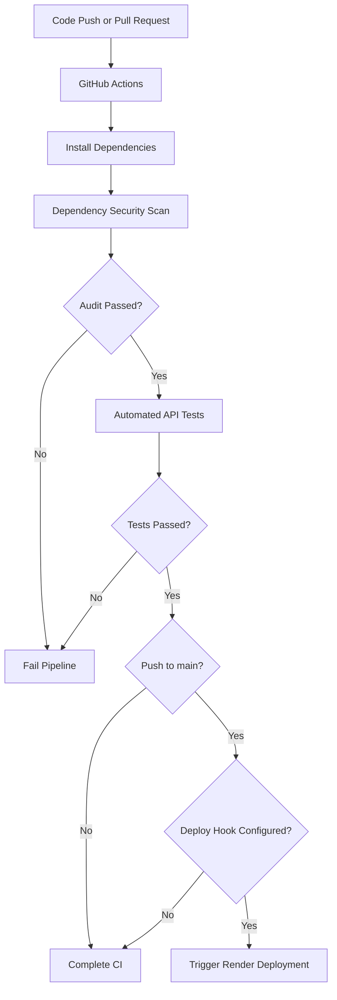

# Secure CI/CD Pipeline — Node.js REST API

A DevSecOps project demonstrating automated testing, dependency vulnerability scanning, and continuous deployment using GitHub Actions.

The pipeline integrates security checks into the software delivery lifecycle, preventing deployment when high or critical dependency vulnerabilities are detected.

## Tech Stack

- **Backend:** Node.js, Express
- **Testing:** Jest, Supertest
- **CI/CD:** GitHub Actions
- **Security:** npm audit, GitHub Actions Secrets
- **Deployment:** Render

## Architecture



## Features

### Automated CI/CD

GitHub Actions runs on:
- Pushes to `main`
- Pull requests targeting `main`
- Scheduled weekly executions

The workflow installs dependencies, performs security checks, runs automated tests, and conditionally triggers deployment.

### Dependency Vulnerability Scanning

The pipeline integrates npm's built-in security auditing:

```bash
npm audit --audit-level=high
```

This checks dependencies against known vulnerability advisories.

If high or critical vulnerabilities are reported, the command fails and prevents subsequent deployment steps from executing.

### Automated Testing

Jest and Supertest validate the application's REST API endpoints.

Test results are preserved as GitHub Actions artifacts for inspection and troubleshooting.

### Secure Deployment

Deployment is triggered through a Render webhook stored as a GitHub Actions secret.

The workflow uses restricted repository permissions and avoids printing sensitive credentials to logs.

Deployment is conditional on:
- Successful dependency installation
- Passing vulnerability checks
- Passing automated tests
- A push to the `main` branch
- A configured deployment webhook

## Security Remediation

An initial dependency audit identified 18 vulnerabilities, including 8 high and 2 critical findings.

Non-breaking dependency updates eliminated all reported high and critical findings at the time of remediation.

The latest verified local audit still reported 20 lower-severity findings (16 moderate, 4 low), primarily within development dependencies.

These findings remain candidates for further remediation. Audit results may change as new vulnerabilities are disclosed.

## Running Locally

### Prerequisites

- Node.js 22
- npm

### Installation

```bash
git clone https://github.com/declan-whitty/cicd-project.git
cd cicd-project
npm ci
```

### Run the Application

```bash
npm start
```

### Run Automated Tests

```bash
npm test
```

### Run Security Audit

```bash
npm audit --audit-level=high
```

## API Endpoints

| Endpoint | Description |
|----------|-------------|
| `/` | Welcome response |
| `/hello` | Returns a JSON greeting |

## Deployment

The application is hosted on Render.

[Live Application](https://cicd-project-aob7.onrender.com/)

GitHub Actions can trigger deployment after successful validation using a deployment webhook stored in repository secrets.

## Future Improvements

- Add automated secret scanning.
- Integrate static application security testing (SAST).
- Expand API test coverage.
- Remediate remaining dependency vulnerabilities.
- Improve deployment monitoring and alerting.

## Project Objectives

This project explores how security controls can be integrated into CI/CD workflows rather than performed solely after deployment.

It demonstrates foundational DevSecOps practices including automated testing, dependency vulnerability management, secure configuration, and controlled software deployment.
